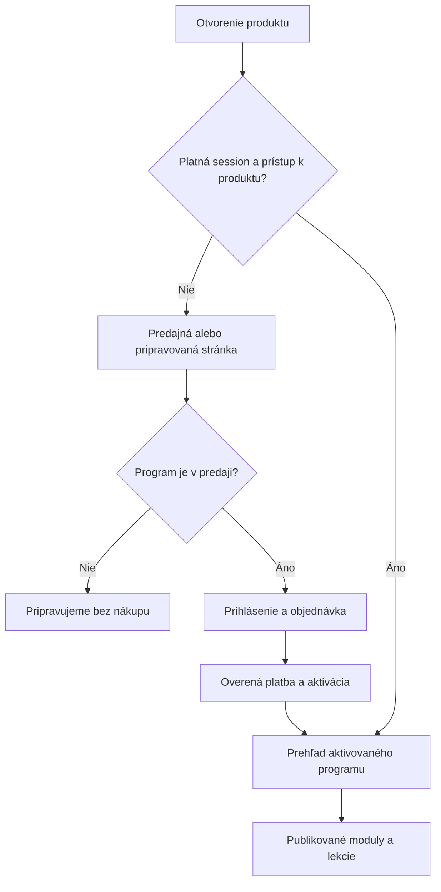

# Klientsky portál Mindbanger

Analýza a implementačný plán z 18. októbra 2026. Stav: návrh, bez zmeny produkčnej aplikácie, databázy alebo platieb.

## Cieľ

Po prihlásení sa otvorí bezplatný účet klienta v platforme Mindbanger. Z neho klient spravuje online živé stretnutia, rezervácie, platby a svoje digitálne produkty. Mindbanger Daily prestane byť predvoleným programom aj podmienkou používania účtu. Engine, starý obsah a administrátorské nástroje zostanú zachované pre prípadné neskoršie využitie.

Výraz „rezervácia vrátane platby“ interpretujeme ako online úhradu pri rezervovaní. Návrh zahŕňa aj zrušenie a vrátenie platby; presné obchodné pravidlá sa určia pred spustením platieb.

## Overený aktuálny stav

Kontrola zdrojov a schémy databázy prebehla iba na projekte Mindbanger `ldjibcxqjbrjsmfppyoi`. Databázové dotazy boli v transakciách READ ONLY, bez načítania klientskych mien alebo kontaktov. Sportbooster nebol kontrolovaný ani menený.

| Oblasť | Zistenie | Dôsledok |
| --- | --- | --- |
| Klienti | 9 profilov: 6 free, 3 premium | Existujúcu identitu a profily zachovať. |
| Predplatné | 3 databázové záznamy active; jedna organizácia active | Ide o stavy v databáze, nie dôkaz aktuálnych platených predplatných v Stripe. Pred finančnými zásahmi zosúladiť s procesorom a rozlíšiť testy. |
| Prihlásenie | Supabase Auth, e-mailový OTP, cookie session, SSR klient a proxy | Základ možno použiť, netreba nový autentifikačný systém. |
| Vstup po prihlásení | Login, registrácia aj callback smerujú na `/mindbanger_daily/app/today` | Klient sa vracia do Daily namiesto svojho účtu. |
| Rozhranie účtu | Tmavý layout, úzky obsah, navigácia Today/Archive/Resets/Audio/Affiliate/Account | Nestačí zmeniť farby; treba zmeniť informačnú architektúru. |
| Prístup | Viaceré obrazovky kontrolujú `profiles.subscription_status`, subscriptions alebo B2B členstvo | Globálny premium stav nie je vlastníctvo konkrétneho produktu. |
| Digitálne produkty | `quick_resets` publikuje audio, osobné nahrávky majú `user_id` | Chýbajú objednávky produktov, samostatné nároky na prístup a všeobecné moduly/lekcie. |
| Pokrok | Viac tabuliek pre daily/onboarding/corporate signály | Nekopírovať ich model pre nový kurz; nové lekcie potrebujú vlastnú väzbu. |
| Rezervácie | Nainštalované tabuľky, ochrana kolízií, expirácia žiadostí, admin, súkromné odkazy a e-mailová fronta | Použiť existujúci základ. Aktuálne 0 rezervácií a verejné rezervovanie vypnuté. |
| Väzba rezervácií | Termín má meno/e-mail, ale nemá `user_id` | Najbližší termín sa zatiaľ nedá bezpečne zobraziť v účte podľa vlastníctva. |
| Úhrada rezervácií | Iba príznak `paid`, bez platobných identifikátorov a refundácií | Označenie zaplatené v admine nenahrádza platobnú integráciu. |
| Platby | Existujúci Checkout používa `mode: subscription` a jednu cenu Daily | Nové jednorazové služby a program potrebujú odlišný checkout a položky objednávky. |
| Automatizácie | Daily e-maily a push vyberajú aktívne predplatné | Vypnutie menu samo nezastaví rozosielanie. |

### Chyby s prednosťou pred novými platbami

1. **Oprávnenia profilov.** `profiles` má zapnuté RLS, ale SELECT policy `true` pre public a SELECT grant pre anon. UPDATE policy povoľuje vlastný riadok; authenticated má UPDATE práva aj na `role` a `subscription_status`. Na profiles nie je ochranný trigger. Opraviť viditeľnosť profilov a odobrať klientovi práva na riadenie oprávnení, členstva a Stripe väzieb. RLS podľa riadku sama neobmedzuje meniteľné stĺpce.
2. **Rozdiel webhooku a databázy.** Kód Stripe handlera používa `processed_stripe_events` so stavmi processing/completed. Táto tabuľka v overenej databáze neexistuje. Existuje odlišná `processed_webhooks` iba s id a created_at. Aktuálny handler má pri chybe prvého INSERT cestu k HTTP 500. Nejde iba o vizuálny problém platby.
3. **Nesúlad profilu a kódu.** Aktuálny profiles nemá stĺpec email, hoci prihlasovací API handler a viaceré staré vetvy tento stĺpec vyhľadávajú. Opraviť podľa identity v Auth a `user_id`; nebudovať autorizáciu ani spájanie nákupov iba podľa zadaného e-mailu.
4. **Serverové overovanie identity.** Viaceré serverové layouty/API používajú getSession. Overovanie identity zjednotiť cez overeného používateľa alebo claims; proxy a skryté tlačidlá nenahrádzajú autorizáciu každého citlivého endpointu.
5. **Spracovanie webhookov.** Aj po oprave tabuľky treba riešiť uviaznutý processing stav, opakovania, udalosti mimo poradia a transakčné zmeny. Niektoré predčasné návraty zo súčasného handlera môžu obísť jeho upratovanie. Úspešný návrat z platobnej stránky nesmie sám aktivovať produkt.

Toto je cielená analýza portálu a platieb, nie úplný bezpečnostný audit všetkých starých B2B a affiliate funkcií. Žiadna zmena oprávnení sa pri analýze neskúšala na účte klienta.

## Navrhované používateľské prostredie

Nový portál má vlastný svetlý layout nezávislý od Daily: krémové pozadie, biele karty, tmavozelené hlavné tlačidlá, jemné zelené a pieskové akcenty. Bežný text 18 px na notebooku a aspoň 16 px na mobile, ovládanie aspoň 44 px vysoké, obsah približne 1440–1600 px široký. Na mobile jeden stĺpec a štyri zrozumiteľné položky navigácie.

Predvolená slovenčina; zachovať existujúci jazyk a časové pásmo klienta, s rozumným fallbackom na Europe/Bratislava. Dátumy ukladať ako UTC a jasne uvádzať pásmo pri výbere a potvrdení. Žiadne preberanie ručných Daily výpočtov dňa programu do rezervácií.

Navigácia: **Prehľad, Rezervácie, Produkty, Môj účet**. Platby a doklady sú samostatná podstránka dostupná z prehľadu a účtu. Osobné audio sa zachová pre jeho vlastníkov ako Moje materiály; Affiliate a Company nebudú predvolené položky bežného klienta.

### Prehľad po prihlásení

1. Privítanie a výrazná karta **Najbližšie online stretnutie**: služba, dátum, čas a pásmo, trvanie, stav úhrady, stav potvrdenia a vstup do hovoru. Najbližší termín je najskoršie nezrušené budúce stretnutie vlastnené klientom. Rozpracovaná úhrada je odlíšená od potvrdeného termínu a ponúkne Dokončiť platbu. Ak nie je termín, zobrazí sa pokojný prázdny stav a Rezervovať stretnutie.
2. **Online živé služby**: zrozumiteľné karty aktuálnych služieb s cenou, trvaním, formou online a vstupom do rovnakého kalendára. Služby aj kalendár majú jeden zdroj konfigurácie, nie cenník skopírovaný do druhého formulára.
3. **Online programy**: zatiaľ jedna karta pripravovaného programu práce s chuťou na sladké. Pracovný názov: „Chuť na sladké pod kontrolou“. Presný názov a predajné texty sa nastavia samostatne, bez sľubu garantovaného zdravotného výsledku.
4. Menšie odkazy na históriu stretnutí, platby/doklady a prípadné vlastné materiály.

Pri nezverejnenej cene ani neotvorenom programe sa nezobrazuje funkčný nákup. Klient uvidí „Pripravujeme“ a podrobnosti programu. Nezobrazovať vymyslené lekcie alebo dosiahnutý pokrok.

## URL a zachovanie prihlásenia

| URL | Úloha |
| --- | --- |
| `/prihlasenie` | Spoločné prihlásenie do platformy. |
| `/registracia` | Vytvorenie účtu s aktuálnymi podmienkami platformy. |
| `/ucet` | Prehľad, bez požiadavky na predplatné. |
| `/ucet/sluzby` | Ponuka živých online služieb. |
| `/ucet/rezervacie` | Vlastné budúce a minulé termíny. |
| `/ucet/rezervacie/[id]` | Detail, úhrada, pripojenie, zrušenie alebo žiadosť o presun. |
| `/ucet/produkty` | Moje programy a dostupná ponuka. |
| `/ucet/platby` | Vlastné objednávky, platby, vratky a odkazy na doklady. |
| `/ucet/profil` | Kontakty, preferencie, odhlásenie a žiadosť o zrušenie účtu. |
| `/produkty/chut-na-sladke` | Rovnaká adresa pre predajnú stránku aj aktivovaný program. |
| `/produkty/chut-na-sladke/lekcie/[slug]` | Chránený obsah konkrétnej lekcie. |

Súčasný Supabase projekt a doména zostanú rovnaké. Predajná stránka prihláseného používateľa použije klientsky obal a zachová session. Neprihlásený návštevník uvidí verejnú prezentáciu produktu. Po prihlásení sa vráti na pôvodný produkt alebo rezerváciu cez bezpečný relatívny returnTo/next; odmietnuť externé adresy a slučky presmerovaní.

Login, registrácia, callback, e-maily aj PWA štart sa upravia spoločne. Staré klientské URL Daily sa presmerujú na zodpovedajúci nový účet; nechať žiť administráciu a technické webhook URL. Zachovať aj už rozoslané auth odkazy a súkromné rezervačné odkazy. Verejná osobná stránka dostane Viditeľné tlačidlo Prihlásiť sa / Môj účet bez zverejnenia Daily ponuky.

### Jedna adresa produktu, dva hlavné stavy

Rozhodnutie sa vykonáva na serveri podľa prístupu ku konkrétnemu produktu, nie podľa premium, lokálneho úložiska ani parametra v URL. Publikačný stav programu a vlastníctvo programu sú dve samostatné veci. V MVP vznikne rámec programu a stavy prístupu; skutočné lekcie, ich funkcie a obsah sa nastavujú samostatne.

Chrániť aj priamu URL lekcie, obsahové API a generovanie podpísaných odkazov na audio/video. Skrytie častí v prehliadači neochráni obsah. Osobné údaje, rezervácie a produktové oprávnenia nesmú byť zdieľane cachované medzi používateľmi.

## Rezervácia online stretnutia a platba

1. Prihlásený klient vyberie službu a termín. Meno a kontakt sa predvyplnia; vlastníkom je vždy overené `user.id` zo servera.
2. Server skontroluje ponuku, aktuálnu cenu a dostupnosť. Transakčne vytvorí dočasnú blokáciu, rezerváciu a objednávku s cenovým a právnym snapshotom. Zachovať PostgreSQL ochranu kolízií a buffer.
3. Vytvorí Stripe Checkout pre jednorazovú platbu. Použiť objednávkové ID, zákazníka priradeného k účtu a idempotency key. Klient neposiela autoritatívnu cenu ani cudzí user_id.
4. Dĺžku blokácie zosúladiť s platnosťou Checkout Session. Opakovaný pokus použije tú istú nezaplatenú objednávku alebo bezpečne nahradí neplatnú session; nevytvára druhý termín ani druhú úhradu tej istej objednávky.
5. Overený webhook po kontrole stavu platby a sumy označí úhradu a potvrdí termín podľa nastavenej politiky. Návratová stránka iba číta stav; pri meškajúcom webhooku zobrazuje „Platbu overujeme“.
6. Pri neúspechu alebo expirácii sa uvoľní blokácia. Ak úspešná platba príde po zániku blokácie, nerezervovať obsadený termín: vytvoriť stav na riešenie a podľa pravidiel zabezpečiť náhradný termín alebo vratku. Nikdy nevytvoriť dvojitú rezerváciu.
7. Potvrdenie a pripomienka používajú trvalú e-mailovú frontu. Klient vidí termín aj v účte. Zlyhanie e-mailu nesmie zrušiť úspešnú úhradu alebo potvrdenie.
8. V MVP môže admin priradiť odkaz na konkrétny online hovor ručne. Automatické vytváranie Zoom/Meet sa rieši neskôr; rezervácia ani platba sa nesmú tváriť ako dokončené vytvorenie hovoru, ak provisioning zlyhal.

Oddeliť stav rezervácie, úhrady a prípravy hovoru. Ukážka: termín confirmed, úhrada paid, odkaz na hovor preparing. Účet ukáže klientovi pravdivý stav a administrátorovi možnosť nápravy.

### Zrušenie a refundácie

- Klient požiada o zrušenie svojho termínu. Server vyhodnotí aktuálne pravidlá a snapshot podmienok prijatých pri objednávke.
- Zrušenie rezervácie a vrátenie peňazí sú odlišné operácie. Rozhranie zobrazuje napríklad „Termín zrušený, vrátenie platby sa spracúva“, nie okamžité „Peniaze vrátené“.
- Úvodná verzia môže používať adminom potvrdenú vratku s MFA. Tá musí prejsť cez Stripe Refund a jeho potvrdenie, nie iba zmeniť boolean v databáze. Automatické vratky podľa storno pravidiel možno pridať následne.
- Evidovať pending/succeeded/failed aj čiastočné vratky, súčet už vrátených súm a unikátny provider refund ID. Opakovaný webhook ani opakovaný klik nesmie spustiť druhú vratku.
- Doklady o úhrade, faktúry a opravné doklady navrhnúť podľa reálneho účtovného postupu prevádzkovateľa; Stripe receipt automaticky neoznačovať za vyriešenú celú účtovnú agendu.

## Databázový model

Rozšírenia vytvárať migráciami s explicitnými grantmi, RLS a testami dvoch klientov. Zachovať existujúce dáta a IDs.

| Entita | Účel a dôležité väzby |
| --- | --- |
| `profiles` | Kontaktné preferencie používateľa. Klient smie upravovať iba povolené polia; oprávnenia a platobné väzby spravuje server. |
| `products` | Stabilné ID, slug, názov, popis, typ, publishing/sales status. Cena a predaj nie sú vlastnenie. |
| `orders`, `order_items` | Vlastník user_id, položky služba/produkt, nemenný názov/cena/trvanie/mena/podmienky, celková suma. Peniaze v najmenších menových jednotkách. |
| `payments` | Objednávka, provider, Checkout Session/PaymentIntent/Charge, suma, mena, stav. Provider ID jedinečné. |
| `refunds` | Úhrada, suma, dôvod, požiadavka/schválenie, provider ID a potvrdený stav. |
| `product_access_grants` | user_id + product_id + zdroj nároku: zaplatená položka, manuálne pridelenie, prípadne budúci balík; stav a čas platnosti. Efektívny prístup existuje pri aspoň jednom platnom nároku. |
| `product_modules`, `product_lessons` | Publikovateľný rámec kurzu, poradie, obsahový typ, privátny súbor a neskoršie pravidlá odomykania. |
| `lesson_progress` | user_id + lesson_id, posledná pozícia, dokončenie; unikátny pár. Zápis až po overení prístupu. |
| `appointments` | Doplniť overeného vlastníka user_id, order_item_id, online formu, meeting URL a stav hovoru, samostatnú úhradovú väzbu a termín zániku blokácie. |
| `webhook_events` | Jeden zjednotený model udalostí s unikátnym event ID, typom, stavom, pokusmi, lease/časmi a chybou; zotavenie po páde procesu. |
| Audit a notifikácie | Rozšíriť existujúci audit/frontu alebo použiť spoločné typované udalosti bez zbytočných kópií osobných údajov. |

Refundácia nákupu produktu ruší iba nárok pochádzajúci z danej položky podľa pravidiel produktu. Nesmie omylom zrušiť iný platný nákup alebo manuálny nárok na ten istý produkt. Čiastočné refundácie a spory majú výslovne nastavené pravidlá, nie automatický globálny zákaz účtu.

Existujúce rezervácie nespájať s účtom iba preto, že klient zadal rovnaký e-mail. Verejný starší termín priradiť až po dôveryhodnom overení vlastníctva. Momentálne je tabuľka prázdna, takže povinnosť vlastníka pre nové rezervácie možno zaviesť čisto. Súkromné odkazy zachovať pre už rozoslané termíny, ak medzičasom vzniknú.

## Vypnutie Daily

Vypnúť predaj a klientsky prístup cez serverový prepínač, napríklad `DAILY_ENABLED=false`. Schovať Daily navigáciu, onboardingové vzorky, upgrade bannery a nastavenia denných push správ. Pri priamom volaní starého Daily checkoutu server odmietne vytvorenie nového predplatného. Rovnaké pravidlo použiť na relevantné staré B2B nákupy Daily.

Zastaviť aj denné e-maily a push, nielen odkazy v menu. Oddeliť tieto úlohy od rezervačných pripomienok a budúcich produktových správ. Skontrolovať cron cesty oproti skutočne existujúcim API handlerom.

Vypnutie ponuky nezastaví už existujúcu obnovovanú platbu v Stripe. Tri záznamy active a aktívnu organizáciu porovnať so Stripe vrátane režimu live/test a aktuálnych období; žiadne hromadné rušenie, mazanie klientov či prepis stavov len na základe tejto analýzy. Historické účtovanie a potrebný billing prístup zachovať počas prechodu.

Engine, staré signály, nahrávky, B2B a affiliate dáta zachovať. Admin ich môže mať oddelené ako Legacy Daily. Nové nároky produktov nepripájať na starý globálny premium stav.

## Implementačné etapy a výstupy

### 0 Bezpečnostný a dátový základ

- Záloha a oddelené testovacie prostredie. Skontrolovať zhodu nasadenej schémy s migráciami a nezopakovať už manuálne aplikovanú migráciu kalendára.
- Opraviť profilové práva, administrátorské role a serverovú identitu. Zjednotiť chýbajúce polia/predpoklady kódu.
- Opraviť tabuľku a spracovanie webhookov, rozlíšiť objednávky produktov, rezervácií a historické predplatné.
- Porovnať stav predplatných so Stripe bez automatických finančných zmien.
- Hotovo, keď dva rôzne účty nevidia cudzie dáta, klient nezmení rolu/nárok a opakovaný webhook je bezpečný.

### 1 Bezplatný účet a nový klientsky dizajn

- Nový ClientShell, prehľad, profil, navigácia a svetlé prihlasovanie/registrácia. Zachovať OTP a existujúce session.
- Aktualizovať návraty po prihlásení, hlavičku verejného webu, e-maily, callback a PWA.
- Vypnúť klientsku Daily ponuku, nové Daily checkouty a automatické denné správy. Zachovať admin a históriu.
- Karta najbližšieho termínu má spočiatku skutočný prázdny stav; žiadne fiktívne rezervácie.
- Hotovo, keď existujúci aj nový používateľ príde do `/ucet`, účet nevyžaduje nákup a staré klientské URL neotvoria paywall Daily.

### 2 Ponuka živých služieb a vlastníctvo termínov

- Doplniť user_id a klientské API rezervácií, prehľad/detail, časové pásma, dočasné blokácie, online formu a ručný meeting link.
- Použiť existujúcu dostupnosť a ochranu kolízií. Pripraviť jednotné objednávky pre nadväzujúcu platbu.
- Hotovo, keď sa vlastný termín zobrazí hore v účte a dva súbežné pokusy nezískajú rovnaký termín. Verejný predaj môže zostať vypnutý do etapy 3.

### 3 Platby za rezervácie

- Jednorazový Checkout, potvrdenie webhookom, transakčný audit/fronta, stránka čakajúcej platby, expirácia, rušenie a adminom riadené refundácie.
- Doplniť podmienky online služby, informácie pred objednaním a potrebné voľby v objednávke. Nenadväzovať na pôvodný model osobnej zmluvy v prevádzke.
- Urobiť testy v Stripe test režime, potom jednu kontrolovanú prevádzkovú skúšku s výslovne schválenou platbou. Cudzím klientom nič automaticky neúčtovať.
- Hotovo, keď úspech/neúspech/oneskorenie/expirácia/vratka majú korektný stav a nevzniknú dve rezervácie ani dve úhrady.

### 4 Katalóg a pripravovaný program

- Jedna produktová karta a detail programu s publikovaným stavom Pripravujeme, bez aktívneho predaja do pripravenia ponuky.
- Serverový resolver návštevník/nezakúpené/aktivované, zachovanie session a bezpečný návrat na produkt.
- Admin môže v testovacom prostredí prideliť nárok na overenie oboch stránok. Pri aktivovanom programe bez publikovaných lekcií zobraziť pravdivý stav prípravy.
- Rámec modulov/lekcií/pokroku pripraviť, obsah a konkrétne funkcie nenavrhované ako hotové.
- Táto etapa môže po etape 1 prebehnúť súbežne s prípravou kalendára.

### 5 Predaj a aktivácia digitálneho produktu

- Po dokončení obsahu a obchodných podmienok zapnúť samostatnú produktovú cenu a Checkout.
- Overená platba vytvorí nárok k objednanej položke; neskoršia návšteva rovnakého URL zobrazí aktívny program.
- Prístup ku každej lekcii, súboru a zápisu pokroku overiť samostatne. Doplniť pravidlá refundácií a zneplatnenia nárokov.

### 6 Overenie celého portálu a nasadenie

- Notebook 1366/1920 a mobil 390 px, klávesnica, čitateľný kontrast a stavy chýb/čakania/prázdneho obsahu.
- Prihlásenie → služba → termín → platba → potvrdenie → účet → pripojenie → zrušenie/vratka.
- Nezakúpený program → predaj → platba → aktivovaný program → lekcia → návrat s uloženým pokrokom.
- Dvaja klienti, expirovaná session, priamy odkaz na cudziu rezerváciu, falšovaný product/user ID, priama URL zamknutej lekcie, duplicitné a oneskorené webhooky, pád spracovania a opakovaná refundácia.
- Produkčný prepínač po etapách a možnosť rollbacku klientského rozhrania bez mazania objednávok, úhrad alebo získaných nárokov. Pri vypnutí predaja musí systém stále vedieť dokončiť už prijatú platbu alebo refundáciu.

## Odporúčané prvé dodanie

Najprv bezpečný bezplatný klientsky účet v svetlom dizajne, vypnutý Daily, správne prihlásenie, ponuka živých služieb a jedna karta pripravovaného programu. Následne aktivovať prepojený kalendár a platby. Obsah programu a jeho špecifické lekcie/funkcie sú samostatná etapa.

Pred otvorením predaja potvrdiť ceny a trvanie služieb, pravidlá rušenia/presunov a refundácií, spôsob online hovoru, účtovné doklady a kontaktné údaje prevádzkovateľa. Pre digitálny program určiť cenu, dĺžku prístupu, dostupnosť obsahu a pravidlá aktivácie; nateraz sa nič z toho nevymýšľa.

## Technické podklady

Repozitár: `src/app/mindbanger_daily/app/layout.tsx`, `app/today/page.tsx`, `app/settings/page.tsx`, `src/components/MobileNavBar.tsx`, `src/app/mindbanger_daily/login/page.tsx`, `join/page.tsx`, `src/app/api/auth/magic-link/route.ts`, `src/app/api/checkout/route.ts`, `src/app/api/webhooks/stripe/route.ts`, `src/app/api/appointments/route.ts`, `src/lib/booking/*`, `supabase/migrations/20261007103443_personal_appointments.sql` a aktuálna databázová schéma/granty/policies.

Overené referencie: [Supabase SSR a serverová identita](https://supabase.com/docs/guides/auth/server-side/creating-a-client?queryGroups=framework&framework=nextjs), [RLS a granty](https://supabase.com/docs/guides/database/postgres/row-level-security), [Stripe webhooky](https://docs.stripe.com/webhooks), [Stripe refundácie](https://docs.stripe.com/refunds). Implementácia musí vychádzať z aktuálnych SDK a testov v oddelenom prostredí.
